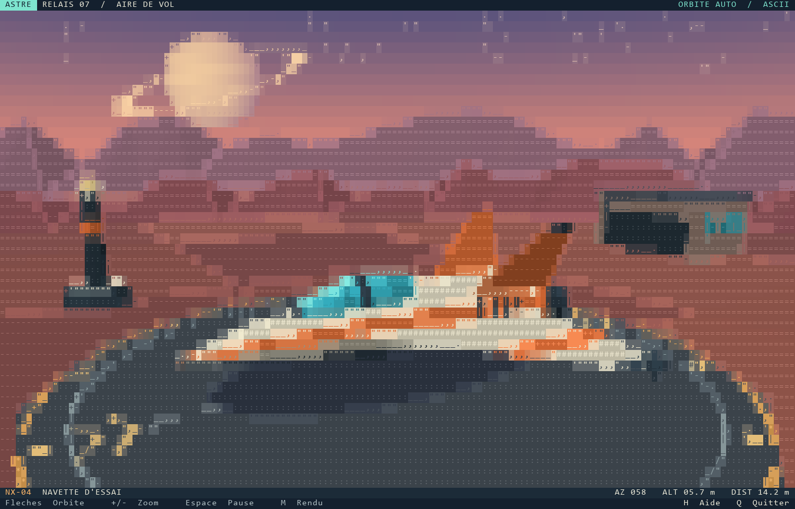

# Astre (oracle C gelé)

> **Référence historique, gelée le 2026-11-24.** Ce dossier est l'oracle de parité du
> moteur, désormais porté en Rust dans [HET](https://github.com/grokuku/HET). Il n'est
> plus le moteur du jeu Shooty : `crates/` (HET) fait foi. Le frontend Quake « Relais de
> Cendre » a été retiré de ce dépôt.

Un moteur 3D en C99 pour les terminaux Linux et Windows. La démo place la caméra en orbite autour de la navette NX-04, en vol stationnaire sur le relais 07. Les flèches permettent d'en examiner les ailes, la verrière et les tuyères sous tous les angles.



*Première image de la démo en ASCII strict, à 150 colonnes sur 48 lignes.*

## Lancer la démo

Sous Windows, ouvrir PowerShell dans Windows Terminal et lancer l'exécutable natif 64 bits.

```powershell
.\astre.exe
```

Pour recompiler sous Windows avec MinGW-w64, utiliser `mingw32-make astre.exe` ou lancer `gcc -O2 -std=c99 -static demo.c demo_scene.c term3d.c terminal.c -lm -o astre.exe`.

Compiler puis lancer la démo depuis le dossier du projet, dans un terminal Linux.

```sh
cc -O2 -std=c99 demo.c demo_scene.c term3d.c terminal.c -lm -o astre
./astre
```

Avec GNU Make, `make` compile également la démo. Elle démarre en Braille couleur, avec une cadence cible de 60 images par seconde. Une fenêtre de **120 × 40 caractères** permet de bien lire les détails. La vue et le HUD s'ajustent quand la fenêtre change de taille.

| Touche | Action |
| --- | --- |
| ← → / ↑ ↓ | Tourner autour de la navette / changer la hauteur de vue |
| + / − | Rapprocher / éloigner la caméra |
| Espace | Mettre l'animation en pause ou la reprendre. La caméra reste contrôlable |
| M | Basculer entre ASCII et Braille sur la même vue |
| Tab | Masquer ou afficher le HUD |
| P | Afficher ou masquer le moniteur de performances |
| R | Retrouver le cadrage initial et l'orbite automatique |
| H / Q | Afficher l'aide / quitter |

## Précision et couleurs

Le moniteur mesure les images présentées par seconde et le temps moyen par image consacré au rendu et à la présentation dans le terminal. Les mesures sont actualisées toutes les demi-secondes, y compris quand la scène est en pause. Le temps de présentation couvre la comparaison des cellules, leur encodage et l’écriture au terminal. Une petite fenêtre affiche uniquement les FPS.

Le moteur rasterise les triangles en perspective et teste la profondeur sur **2 × 4 échantillons par cellule**. À 120 × 40 caractères, la géométrie est donc calculée sur une grille de 240 × 160. La projection tient compte des proportions de la police. Les triangles qui traversent le plan proche sont découpés.

- **ASCII** utilise exclusivement des caractères imprimables de l'ASCII. Le moteur choisit un caractère de contour ou de densité et règle séparément les couleurs de l'encre et du fond.
- **Braille** représente les contours avec des motifs Unicode à huit points. Le moteur utilise aussi des demi-blocs et des quadrants lorsque la forme s'y prête. Ce mode demande une police de terminal avec ces glyphes. Chaque cellule dispose de deux couleurs.

Pour comparer les deux rendus sur une scène immobile, appuyer sur **Espace**, puis sur **M**. Pour démarrer directement en ASCII, utiliser la commande suivante.

```sh
./astre --mode ascii
```

Le mode couleur par défaut utilise le RVB 24 bits. Sur un terminal à palette indexée, lancer `./astre --palette 256`. Si les formes paraissent étirées, régler le rapport largeur/hauteur d'une cellule, par exemple `--cell-aspect 0.45` pour une cellule de 9 × 20 pixels.

## Réutiliser le moteur

[term3d.h](term3d.h) expose la caméra, les triangles, la conversion en caractères et le HUD. [terminal.h](terminal.h) gère les touches, la taille de fenêtre et la présentation ANSI. Le backend conserve la dernière image et écrit uniquement les cellules modifiées. L'écran alternatif est libéré à la sortie.

Ce programme minimal dessine un triangle et ancre un compteur de coque en bas à gauche.

```c
#include "term3d.h"
#include "terminal.h"

int main(void) {
    T3Frame *f = t3_create();
    if (!f || !t3_resize(f, 80, 24)) {
        t3_destroy(f);
        return 1;
    }

    T3Camera camera = {
        .eye = {0, 0, 4}, .target = {0, 0, 0},
        .fov_y = 0.9f, .near_z = 0.1f, .cell_aspect = 0.5f
    };
    t3_begin(f, camera, NULL, NULL);
    t3_triangle(f, t3_vec(-1, -1, 0), t3_vec(1, -1, 0), t3_vec(0, 1, 0),
                t3_rgb(240, 128, 61));
    t3_resolve(f, T3_ASCII);
    t3_text(f, T3_BOTTOM_LEFT, 1, 0, "COQUE 100%", t3_rgb(235, 240, 230),
            t3_rgb(20, 32, 46));
    bool ok = t3_snapshot(stdout, f, T3_TRUECOLOR);
    t3_destroy(f);
    return ok ? 0 : 1;
}
```

Enregistrer ce programme dans `triangle.c`, puis lancer `cc -O2 -std=c99 triangle.c term3d.c terminal.c -lm -o triangle && ./triangle`.

Pour une boucle de jeu, appeler `t3_begin`, dessiner la scène, appeler `t3_resolve`, dessiner le HUD, puis appeler `t3_present`. Le HUD utilise quatre ancrages, des coordonnées entières en cellules et un fond opaque. Les textes du HUD sont en ASCII imprimable, à raison d'une colonne par caractère. [demo.c](demo.c) montre la boucle complète avec le clavier et le redimensionnement. [demo_scene.c](demo_scene.c) construit la géométrie, applique l'éclairage des faces et anime la navette.

## Captures et vérification

```sh
# Capture couleur à un instant et à une taille reproductibles
./astre --snapshot --time 8 --size 120x40 > navette.ans
cat navette.ans

# Version texte sans séquences de couleur
./astre --snapshot --plain --size 80x24

# Tests de profondeur, de découpage, de glyphes et d'ancrage du HUD
make check
```
